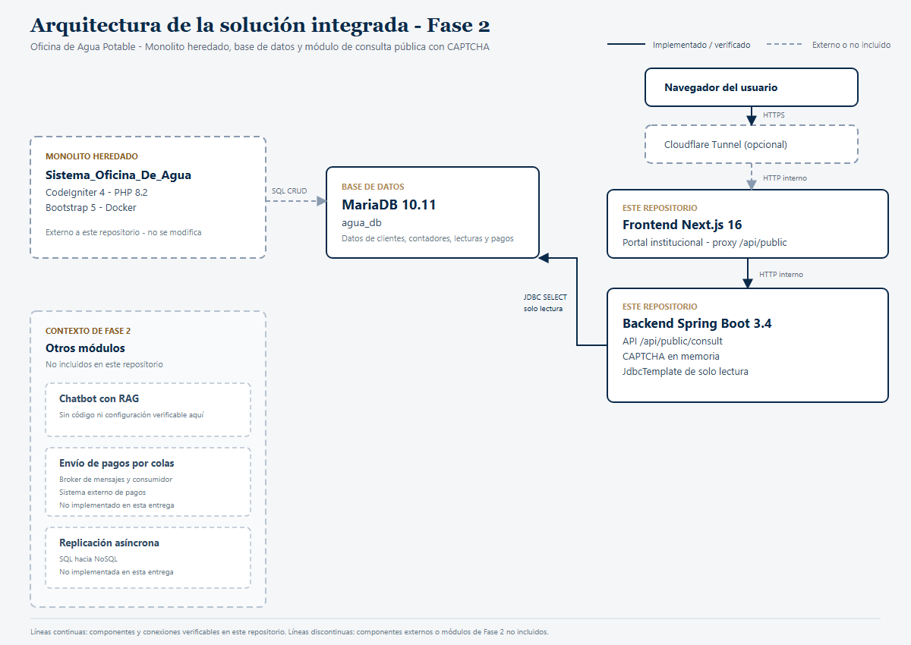
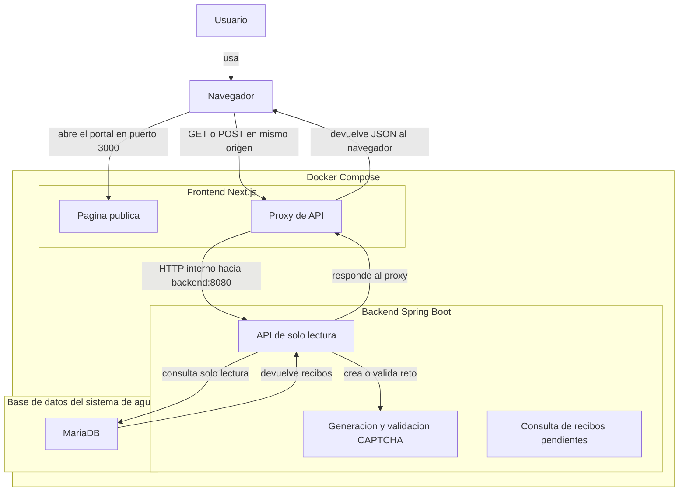

Nombre: Alan Steven Marroquín Villaseñor  
Carnet: 0905-23-15264  
Repositorio: https://github.com/Grupo-1-Sistema-de-agua/consulta-publica-captcha  
Modulo asignado: Consulta pública con captcha.  

# Consulta pública con CAPTCHA

Portal web para consultar información pública básica mediante una interfaz Next.js y una API Spring Boot de solo lectura. El CAPTCHA se genera y se valida en el backend. El proyecto se inicia con Docker Compose y consulta la base de datos real del sistema de agua en modo solo lectura.

> **Alcance de esta entrega:** el contenido disponible en este directorio implementa el módulo de consulta pública con CAPTCHA y su conexión de solo lectura a la base de datos del sistema de agua. La arquitectura de la solución integrada de Fase 2 se documenta como contexto, pero el monolito heredado, el chatbot con RAG, el envío de pagos por colas y la replicación asíncrona NoSQL/SQL no forman parte del código de este repositorio y no se presentan como implementados aquí.

## Estructura del repositorio y commits

Todos los commits referencian la historia de Jira **SDGA-79 - F2-1: Consulta pública con captcha**.

| Commit | Qué hace | Dónde mirar |
|---|---|---|
| `SDGA-79 chore: configurar repositorio y variables de entorno` | Configura el repositorio, `.gitignore` y `.env.example`. | `.gitignore`, `.env.example` |
| `SDGA-79 feat(backend): agregar API de captcha y consulta de recibos` | Implementa el backend Spring Boot, el CAPTCHA y la consulta JDBC. | `backend/` |
| `SDGA-79 feat(frontend): agregar portal institucional de consulta` | Implementa el portal Next.js, la búsqueda y la impresión. | `frontend/` |
| `SDGA-79 build(docker): agregar compose para ejecutar el captcha` | Define los contenedores, la conexión a MariaDB y el túnel opcional. | `docker-compose.yml` |
| `SDGA-79 docs: agregar arquitectura, diagrama y guia de prueba` | Documenta la arquitectura, el diagrama y los datos de prueba. | `README.md`, `docs/` |

Cada commit incluye en su mensaje la lista de cambios que introduce y la referencia `SDGA-79`.

## Arquitectura

### Arquitectura de la solución integrada (Fase 2)



La solución Fase 2 de la Oficina del Agua se organiza alrededor de un monolito heredado y una base de datos MariaDB compartida. Sobre ese sistema existente se agregan cuatro funcionalidades nuevas. Este repositorio implementa una de ellas: la consulta pública con CAPTCHA.

**Monolito heredado.** Es la aplicación existente de la Oficina de Agua, desarrollada en PHP 8.2 con CodeIgniter 4 y Bootstrap 5. Gestiona clientes, contadores, lecturas, tarifas, pagos y usuarios. No se modifica en esta entrega; su base de datos es la fuente de información del módulo público.

**Base de datos MariaDB.** El monolito y el módulo de consulta pública comparten la base `agua_db` en MariaDB 10.11. El backend del captcha se conecta con un usuario de solo lectura y consulta las tablas `Tb_Clientes`, `Tb_Contadores`, `Tb_Lecturas` y `Tb_Pagos`. No ejecuta operaciones de escritura.

**Módulo de consulta pública con CAPTCHA (este repositorio).** Está formado por un frontend Next.js 16 y un backend Spring Boot 3.4 con Java 21. El navegador entra al portal, el frontend actúa como proxy hacia el backend, el backend genera y valida el CAPTCHA y, si la verificación es correcta, devuelve los recibos pendientes del cliente consultado. El túnel de Cloudflare es opcional y solo se usa para la presentación.

**Otros módulos de Fase 2.** El chatbot con RAG, el envío de pagos por colas y la replicación asíncrona NoSQL/SQL forman parte del contexto de la solución, pero no están incluidos en este repositorio. No hay código, endpoints, brokers ni configuración de replicación verificables aquí, por lo que no se presentan como implementados.

> **Alcance del repositorio:** este repositorio contiene únicamente el módulo de consulta pública con CAPTCHA. El monolito heredado y su base de datos son externos; los otros tres módulos de Fase 2 no están incluidos.

### Diagrama del módulo de consulta pública

El siguiente diagrama detalla el flujo interno del módulo implementado en este repositorio.

<!-- mermaid-checked: no \n, no em-dash/en-dash, no {} in labels, subgraphs are id["label"], arrows are -->|"label"|, all subgraphs closed by end, ids unique -->


### Qué representa el diagrama del módulo

- **Usuario y navegador:** la persona abre el portal en `http://localhost:3000` y completa la verificación.
- **Página Next.js:** presenta el formulario, la imagen CAPTCHA y el resultado.
- **Proxy de API:** permite que el navegador use rutas del mismo origen (`/api/public/...`) y reenvía las peticiones al backend. Así el navegador no necesita conocer la dirección interna del servicio Docker.
- **API Spring Boot:** ofrece `GET /api/public/captcha` y `POST /api/public/consult`. La segunda ruta responde solo si el CAPTCHA es válido.
- **CAPTCHA:** el backend genera una imagen y conserva temporalmente la respuesta en memoria. El reto vence a los tres minutos, permite hasta cinco intentos y se elimina al validarse o agotarse los intentos.
- **Consulta de recibos pendientes:** cuando el CAPTCHA es válido, el backend consulta en modo solo lectura la base de datos del sistema de agua y devuelve las lecturas que todavía no tienen un pago activo, con número de recibo, cliente, dirección, contador, monto y fecha.

### Componentes de la solución y estado en este repositorio

| Componente | ¿Está en este repositorio? | Función y evidencia |
|---|---|---|
| Monolito heredado CodeIgniter 4 | No, es externo | Sistema existente de la Oficina de Agua. No se modifica; solo se usa su base de datos. |
| Base de datos MariaDB `agua_db` | No, es externa | Fuente de clientes, contadores, lecturas y pagos. El backend la consulta en solo lectura. |
| Consulta pública con CAPTCHA | Sí | Frontend Next.js, backend Spring Boot, API `/api/public` y conexión JDBC. |
| Chatbot con RAG | No | Sin código, endpoint ni configuración verificable en este repositorio. |
| Envío de pagos por colas | No | Sin broker, consumidor ni integración con sistemas externos en este repositorio. |
| Replicación asíncrona NoSQL/SQL | No | Sin configuración de replicación en este repositorio. |

El diagrama usa líneas continuas para los componentes y conexiones verificables en este repositorio, y líneas discontinuas para los componentes externos o módulos de Fase 2 que no están incluidos.

### Stack y almacenamiento

| Capa | Tecnología | Versión declarada | Propósito |
|---|---|---:|---|
| Interfaz y servidor web | Next.js, React, TypeScript | 16.4.3, 19.0.0, 5.8.2 | Renderiza el portal y ofrece el proxy del API |
| API | Spring Boot, Java | 3.4.4, 21 | Expone el CAPTCHA y la consulta de solo lectura |
| Contenedores | Docker Compose | Compose Specification | Construye y conecta frontend y backend |
| Persistencia | MariaDB del sistema de agua | 10.11 | Lectura de recibos pendientes; no se escriben datos |

El CAPTCHA se conserva en memoria del proceso Spring Boot; no se persiste. La única integración externa es la conexión JDBC de solo lectura a la base de datos del sistema de agua.

### Ejecución del proyecto disponible

Requisitos:

- Docker Desktop con Docker Compose activo.
- Una instancia de MariaDB con la base de datos del sistema de agua accesible desde el contenedor. Por defecto el backend busca `host.docker.internal:3306/agua_db`; si la base está en otro host o puerto, ajusta `SPRING_DATASOURCE_URL` en `docker-compose.yml` o en las variables de entorno.

Este repositorio contiene **solo el módulo de consulta pública con CAPTCHA**. No incluye el sistema de agua, sus migraciones ni su aplicación web; únicamente consume su base de datos en modo solo lectura.

Desde este directorio:

```bash
docker compose up --build
```

Después, abre [http://localhost:3000](http://localhost:3000). El backend publica el puerto 8080 para pruebas directas y su estado se puede comprobar con:

```bash
curl http://localhost:8080/actuator/health
```

Para detener los servicios del captcha:

```bash
docker compose down
```

Este comando levanta **solo el captcha**, no el resto de la solución integrada de Fase 2.

### Publicación temporal con Cloudflare Tunnel

Para la presentación se puede generar una URL pública que apunte al portal local sin abrir puertos en el router. Se usa un **túnel rápido de Cloudflare**, que no requiere cuenta ni dominio propio.

Con el captcha ya levantado, inicia el servicio `cloudflared`:

```bash
docker compose --profile tunnel up -d cloudflared
```

La URL pública aparece en los logs:

```bash
docker compose --profile tunnel logs cloudflared
```

Busca una línea con esta forma:

```text
https://<nombre-aleatorio>.trycloudflare.com
```

Cada vez que se recrea el túnel, Cloudflare asigna una URL nueva. Para cerrar el acceso público:

```bash
docker compose --profile tunnel stop cloudflared
```

El portal local sigue disponible en `http://localhost:3000`.

> **Advertencia:** la URL del túnel es pública. Cualquier persona que la reciba puede abrir el portal y consultar los datos que éste expone. Para una presentación se recomienda usar datos de prueba o anonimizados, no la base real de clientes, y cerrar el túnel inmediatamente después de la demostración.

Para un DNS fijo con un dominio propio se necesita una cuenta de Cloudflare, un dominio administrado allí y un túnel con nombre. El flujo general es: `cloudflared tunnel login`, `cloudflared tunnel create`, configurar el hostname en `config.yml`, ejecutar `cloudflared tunnel route dns` y luego `cloudflared tunnel run`. La URL quedaría como `https://agua.tudominio.com` apuntando a `http://localhost:3000`.

## Módulo asignado: consulta pública con CAPTCHA

### Funcionalidad y objetivo

El módulo presenta una página institucional para consultar los recibos pendientes de un cliente del sistema de agua después de verificar que quien hace la solicitud completó un CAPTCHA. El usuario ingresa su **nombre** o **número de teléfono**; el portal no muestra todos los recibos, solo los del cliente que coincide con la búsqueda. El formulario es de solo lectura: no crea ni modifica registros.

El objetivo de negocio es reducir las consultas presenciales y telefónicas para conocer saldos pendientes, ofreciendo una consulta pública segura, disponible fuera del horario de oficina y sin exponer el listado completo de clientes.

La consulta devuelve las lecturas que todavía no tienen un pago activo en la base de datos del sistema de agua. Para cada recibo pendiente se muestra número de recibo, número de contador, monto total, fecha de emisión y estado. También se muestra el total pendiente por cliente.

Cada fila de la tabla incluye un botón **Imprimir** que genera un comprobante individual con los datos del titular y el monto de ese recibo. El botón **Imprimir estado de cuenta** del pie genera el documento completo con todos los recibos pendientes del cliente.

### Integración y responsabilidades

1. El navegador carga la página y solicita un CAPTCHA al endpoint del mismo origen `GET /api/public/captcha`.
2. El servidor Next.js recibe esa solicitud en `/api/public/[...path]` y la reenvía a `http://backend:8080` en la red privada de Compose.
3. Spring Boot genera una imagen PNG, devuelve su identificador y guarda la respuesta del reto en memoria.
4. El navegador envía el identificador, la respuesta escrita y el texto de búsqueda (nombre o teléfono) a `POST /api/public/consult`, también a través del proxy Next.js.
5. Spring Boot valida el reto y, si es correcto, consulta la base de datos del sistema de agua con una sentencia `SELECT` de solo lectura. Si la respuesta es incorrecta, venció o ya se usó, devuelve un error HTTP 400.

El frontend no accede directamente a la base de datos. La conexión JDBC vive únicamente en el backend y se configura con las variables `SPRING_DATASOURCE_URL`, `SPRING_DATASOURCE_USERNAME` y `SPRING_DATASOURCE_PASSWORD`.

### Decisiones técnicas

- **Proxy del lado del servidor Next.js:** mantiene las llamadas del navegador bajo el mismo origen y usa el nombre DNS interno `backend` solo entre contenedores. Se eligió frente a llamar al backend directamente desde el navegador para no depender de exponer su puerto ni configurar CORS. La dirección del backend se configura en Docker Compose mediante `API_URL`.
- **CAPTCHA local en Spring Boot:** se genera sin claves, cuenta externa ni llamada a terceros. Los retos son de un solo uso, expiran a los tres minutos, permiten cinco intentos y tienen un límite de retos pendientes. El estado en memoria es sencillo para una sola instancia de demostración; no es compartido entre réplicas y se pierde al reiniciar el backend.
- **Consulta de solo lectura a la base de datos del sistema de agua:** el backend usa `JdbcTemplate` y una sentencia `SELECT` que une lecturas, contadores, clientes y pagos. No se ejecutan `INSERT`, `UPDATE` ni `DELETE`. La conexión se configura por variables de entorno y la credencial debe ser de solo lectura en producción.

### Cómo probar el módulo

#### Datos de prueba sin información sensible

Si no tienes acceso a la base real del sistema de agua, puedes crear una base de demostración con datos ficticios:

```bash
docker run --name captcha-demo-db \
  -e MARIADB_ROOT_PASSWORD=demo_root \
  -e MARIADB_DATABASE=agua_db \
  -e MARIADB_USER=agua_user \
  -e MARIADB_PASSWORD=cambiar_password \
  -p 3306:3306 -d mariadb:10.11

docker exec -i captcha-demo-db mariadb -u root -pdemo_root agua_db < docs/demo-data.sql
```

Si el puerto 3306 está ocupado, publica la base en otro puerto, por ejemplo `-p 3307:3306`, y ajusta `SPRING_DATASOURCE_URL` en `docker-compose.yml` para usar `host.docker.internal:3307`.

Luego levanta el captcha con `docker compose up --build`.

**Datos de prueba:**

| Búsqueda | Resultado esperado |
|---|---|
| `Cliente Demo Uno` o `5555-0001` | 2 recibos pendientes, total Q200.00 |
| `Cliente Demo Dos` o `5555-0002` | 1 recibo pendiente, total Q120.00 |
| `Cliente Demo` | 3 recibos en total, Q320.00 |
| `Sin Coincidencias` | Mensaje “No se registran adeudos” |

El detalle de los datos ficticios está en [docs/demo-data.sql](docs/demo-data.sql).

#### Pasos de prueba

1. Requisito: una instancia de MariaDB con la base de datos del sistema de agua accesible en `host.docker.internal:3306` (o ajusta `SPRING_DATASOURCE_URL`). Desde este directorio ejecuta:

```bash
docker compose up --build
```

2. Abre [http://localhost:3000](http://localhost:3000). Debe aparecer el formulario, el campo de nombre o teléfono y una imagen CAPTCHA.
3. Escribe un nombre o teléfono que exista en la base de datos de prueba y resuelve los seis caracteres de la imagen. Si el CAPTCHA está distorsionado, usa el botón de recarga para generar otro.
4. Pulsa **Consultar estado de cuenta**. Una verificación válida debe mostrar los datos del cliente y la tabla de **recibos pendientes** con monto, fecha y estado.
5. En la fila del recibo que se desea pagar, pulsa **Imprimir**. Se generará un comprobante individual con ese recibo y el monto correspondiente.
6. Prueba con un texto incorrecto: el formulario mostrará el error de validación y solicitará un CAPTCHA nuevo.
7. Comprueba el estado del backend con `curl http://localhost:8080/actuator/health`; debe responder con estado `UP`.

Cada CAPTCHA es aleatorio; no hay un código fijo ni datos personales reales dentro del repositorio. Un CAPTCHA no puede reutilizarse tras una validación correcta y expira después de tres minutos.

## Seguridad y estado de publicación

- La conexión a la base de datos usa variables de entorno. El archivo `.env` está excluido del repositorio; solo se publica `.env.example` con valores de ejemplo.
- En producción se debe usar un usuario de base de datos de solo lectura y no reutilizar la contraseña administrativa.
- El backend publica el puerto 8080 para pruebas y el frontend el 3000. En producción conviene exponer solo el frontend y mantener el backend en la red interna.
- El CAPTCHA se mantiene en memoria, por lo que la configuración está limitada a una instancia del backend.
- No se publican contraseñas, tokens, claves de API ni el contenido de archivos `.env`.
- El repositorio debe ser público o permitir el acceso del docente sin solicitar permisos. La URL del campo `Repositorio:` debe coincidir con el enlace entregado en la plataforma.
- La arquitectura completa de Fase 2 se documenta como contexto. El código del monolito heredado y de los otros tres módulos no está incluido en este repositorio.
